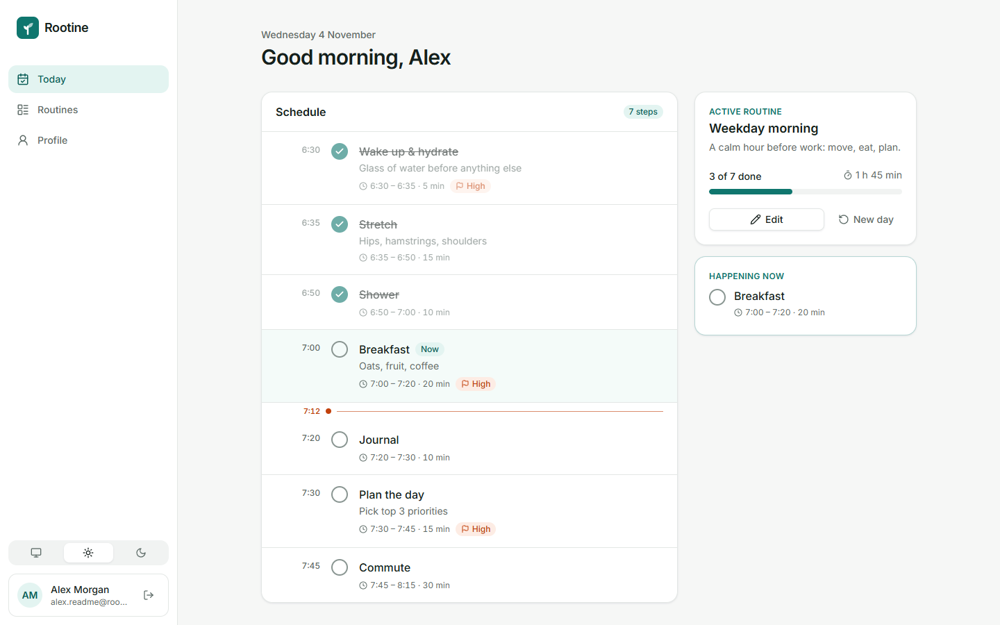
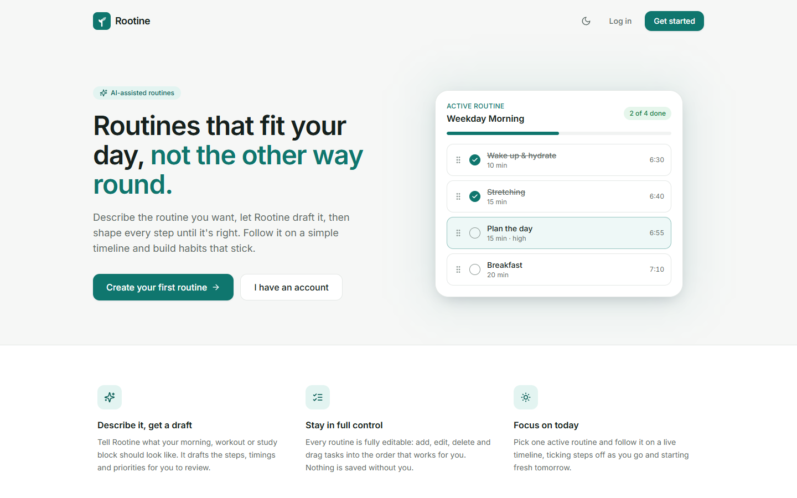
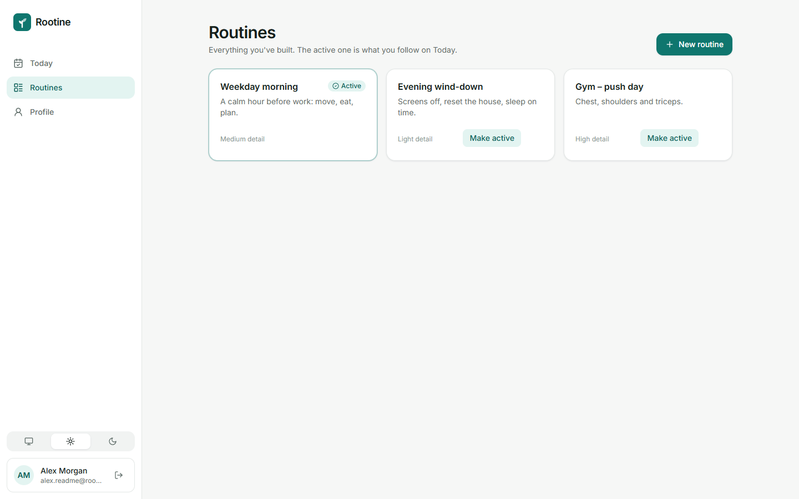
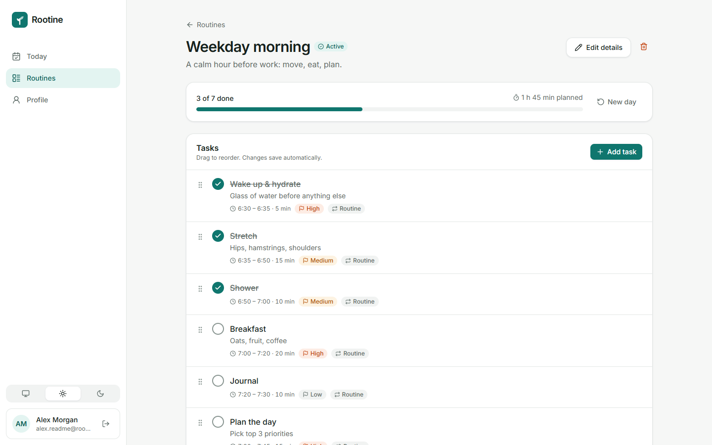
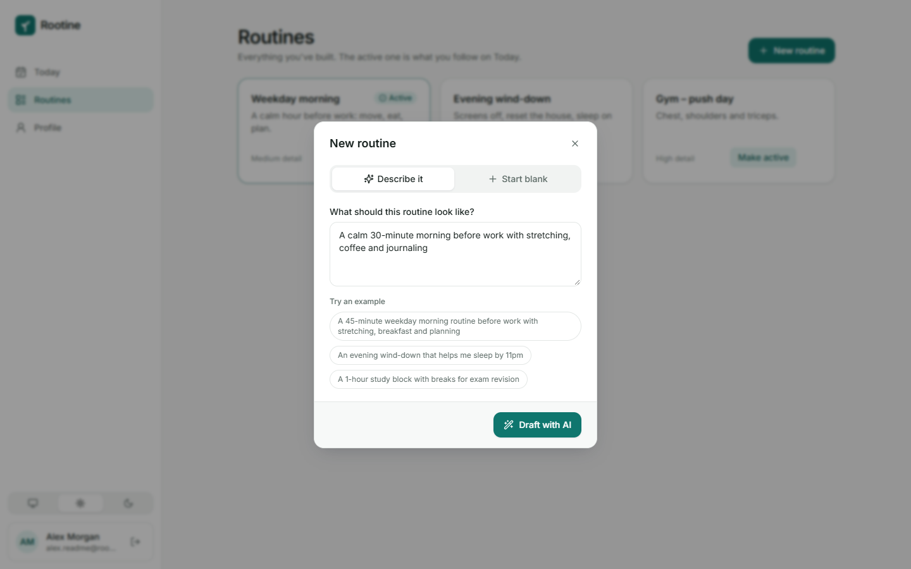
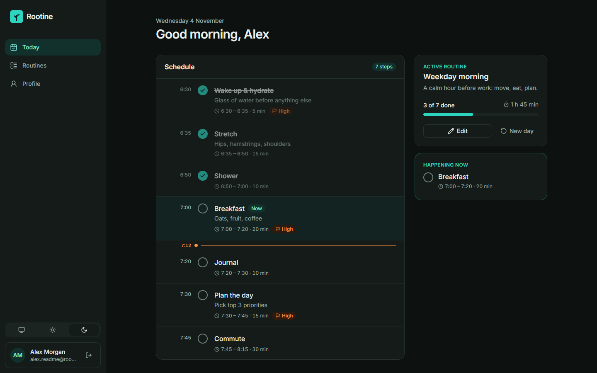
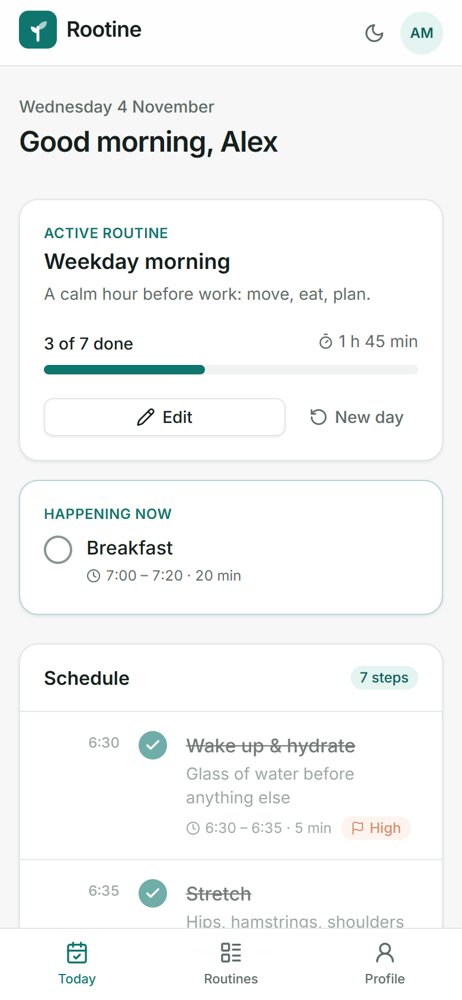

# Rootine

Rootine is an AI-assisted routine manager. Describe the routine you want, let AI turn it into a structured draft, then shape every step yourself and follow it on a live timeline each day.



---

## Features

- **AI routine drafts** – describe a routine in plain language and Rootine drafts the name, steps, start times, durations and priorities. You review and edit the draft before anything is saved.
- **Full routine and task management** – create, edit and delete routines; add, edit, delete and drag-and-drop reorder their tasks.
- **Today view** – pick one active routine and follow it on a timeline with a live "now" marker, a *Happening now / Up next* card, progress tracking, and a *New day* button that unticks every step.
- **Accounts** – sign up and log in with JWT-based auth; every routine and task is scoped to its owner. Update your name or delete your account from the profile page.
- **Light and dark themes** – follow the system setting or pick one; the choice is saved per device.
- **Responsive layout** – sidebar navigation on desktop, bottom tab bar on mobile.

## Screenshots

| Landing page | Your routines |
| --- | --- |
|  |  |

| Routine detail: drag to reorder, tick off, edit | Create a routine by describing it |
| --- | --- |
|  |  |

| Dark theme | Mobile |
| --- | --- |
|  |  |

---

## Tech stack

| Layer | Stack |
| --- | --- |
| Frontend (`rootine-frontend/`) | React 19, Vite 7, Tailwind CSS 4, React Router 7, TanStack Query, dnd-kit, Sonner, Lucide icons |
| Backend (`rootine-api/`) | Java 17, Spring Boot 3.4, Spring Security + JWT (jjwt), Spring Data JPA, OpenAI Java SDK (`gpt-5-mini`) |
| Database | PostgreSQL 17, schema managed by Flyway migrations |
| Tests | End-to-end API tests against a real embedded PostgreSQL (no Docker needed) |

---

## Getting started

You need Java 17+, Node.js 20+, and PostgreSQL (or Docker to run it).

### 1. Database and API

```bash
cd rootine-api
cp .env.example .env   # then set DB_PASSWORD and JWT_SECRET (openssl rand -base64 48)
docker compose up -d db
./mvnw spring-boot:run  # mvnw.cmd spring-boot:run on Windows
```

The API runs on <http://localhost:8080>. Flyway creates the schema on first start.

`OPENAI_API_KEY` is optional. Without it the app works normally, and only the AI draft endpoint responds with `503`.

### 2. Frontend

```bash
cd rootine-frontend
cp .env.example .env.local   # VITE_API_BASE_URL defaults to http://localhost:8080
npm install
npm run dev
```

Open <http://localhost:5173>, create an account, and add your first routine.

### Useful commands

| Command | Where | What it does |
| --- | --- | --- |
| `./mvnw test` | `rootine-api/` | Runs the API test suite |
| `./mvnw clean package` | `rootine-api/` | Builds the API jar |
| `docker compose up -d` | `rootine-api/` | Runs PostgreSQL and the API together |
| `npm run build` | `rootine-frontend/` | Production build into `dist/` |
| `npm run lint` | `rootine-frontend/` | ESLint |

More detail lives in [`rootine-api/README.md`](rootine-api/README.md) and [`rootine-frontend/README.md`](rootine-frontend/README.md).

---

## API overview

All endpoints except register and login need an `Authorization: Bearer <token>` header, and only ever return the signed-in user's data.

| Area | Endpoints |
| --- | --- |
| Auth | `POST /auth/register`, `POST /auth/login`, `GET /auth/me` |
| Current user | `GET /user/me`, `PUT /user/me`, `DELETE /user/me` |
| Routines | `GET /routine`, `GET /routine/{id}`, `POST /routine` (optionally with its tasks), `PUT /routine/{id}`, `DELETE /routine/{id}`, `POST /routine/{id}/activate`, `POST /routine/{id}/reset` |
| Tasks | `GET /task/{id}`, `GET /task/routine/{routineId}`, `POST /task`, `PUT /task/{id}`, `DELETE /task/{id}`, `PUT /task/routine/{routineId}/reorder` |
| AI | `POST /openai/response` – plain-text prompt in, JSON routine draft out |

### Domain model

- **User** – name, email, hashed password, created/last-login timestamps.
- **Routine** – belongs to a user; name, description, detail level (`low` / `medium` / `high`), active flag. Owns an ordered list of tasks.
- **Task** – title, description, type (`routine`, `one_time`, `event`, `habit`), start time, duration in minutes, priority, completed flag, position.

---

## Product principles

1. **The user stays in control.** AI drafts; the user reviews, edits and saves. Nothing AI-generated is persisted without confirmation.
2. **Structured data over free text.** AI output becomes editable routines and tasks, not a chat transcript.
3. **Reliable CRUD first.** Creating, editing, reordering and deleting must be dependable before smarter features are added.
4. **AI accelerates, it doesn't obscure.** It should make building routines faster without making the app harder to trust.
5. **Leave room for context-awareness.** The model is shaped so calendars, events and preferences can feed in later.

---

## Status and roadmap

Working today: accounts, routine and task CRUD with drag-and-drop ordering, AI routine drafts with review, the Today timeline, and light/dark themes.

Next up:

- AI-assisted **updates** to an existing routine ("make this shorter, add journaling before breakfast")
- CI on GitHub Actions
- User context (preferences and constraints that feed routine generation) and routine templates
- Later: calendar-based events, smart adjustments, reminders, and deployment

See [`ROADMAP.md`](ROADMAP.md) for phases, and [GitHub Issues](https://github.com/ch-ezey/rootine/issues) for individual tasks.

---

## Repository layout

```
rootine/
├── rootine-api/        Spring Boot API (auth, routines, tasks, AI drafts)
├── rootine-frontend/   React + Vite web app
├── docs/screenshots/   Images used in this README
└── ROADMAP.md
```
